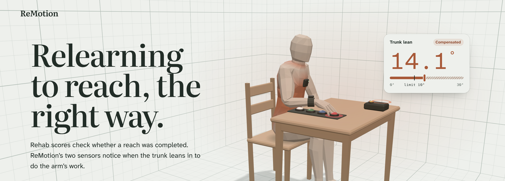

# ReMotion

A seated reach trainer for people recovering from a stroke. Two small motion sensors notice when
the body leans in to do the arm's work, a buzzer says so in the moment, and a therapist sees every
reach afterwards.

ECE 198, University of Waterloo, Group 19, for CCCARE.

## Why we built it

After a stroke, many people can't move their arm as far as they used to. So when they reach for a
cup, they lean their chest forward and let the trunk cover the distance. Therapists call this
*compensation*. It works, which is the problem: the arm never gets the practice, and the lean turns
into a habit that's hard to undo.

In the clinic, a therapist catches it and says "sit back". At home there's nobody watching, and
the usual rehab scores only ask whether the reach was completed, not how. We wanted something a
patient could use at their kitchen table that does the therapist's job for that one thing: notice
the lean, say so right away, and keep a record.

Research says this is possible with cheap sensors. Studies with a wrist and a trunk sensor picked
out leaned reaches about 9 times in 10 ([Ranganathan et al., 2017](https://doi.org/10.1088/1361-6579/aa9835);
[Seo et al., 2024](https://doi.org/10.3390/s24020554);
[Gabler et al., 2026](https://arxiv.org/abs/2604.12591)). In our team's first test, ReMotion
agreed with a blind label from side-view video on **12 of 13 reps**. Our target is 9 in 10 over more
reps and testers, and
[`docs/TESTING.md`](docs/TESTING.md) is how we measure it.

## What we built

Three pieces that work together.

**The device.** A mat with a white HOME button and three coloured target buttons, a yellow START
button, a buzzer, and two motion sensors: one on a chest strap, one on the wrist. The patient sits
up straight for 3 seconds so it learns what "upright" means for them. Then a target lights up,
they reach for it, and come back to HOME. If the chest tilts more than 10° for longer than 0.2 s,
that reach counts as leaned.

| The electronics, inside the box | Putting it together |
|---|---|
| 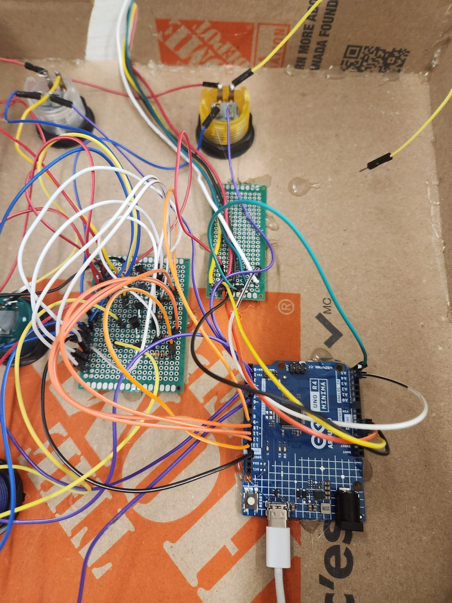 | 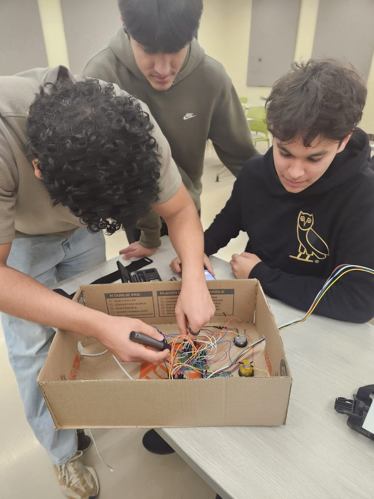 |

A session is the same for every exercise: **3 reaches without the buzzer, 10 with it, 3 without
again.** The first three show how they move on their own. The middle ten are the training, where
the buzzer sounds whenever they lean. The last three show whether it stuck once the buzzer goes
quiet.

**The phone app** (Android). The phone props up on the table, plugs into the device, and coaches
the patient in large type that's readable from arm's length. It also sends every reach to the
dashboard over Wi-Fi.

| Get set up and choose the exercise | One instruction at a time |
|---|---|
| 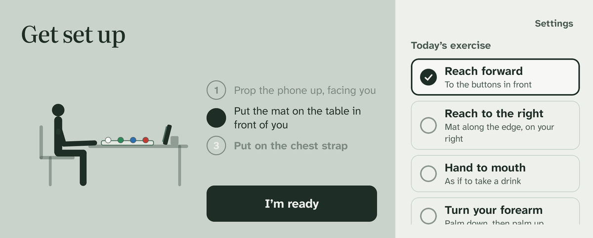 | 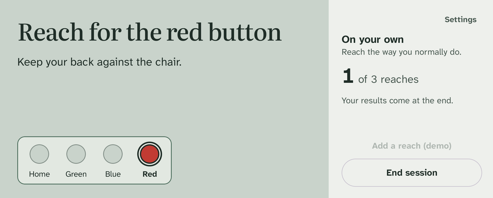 |
| **When they lean** (buzzer block only) | **At the end** |
| 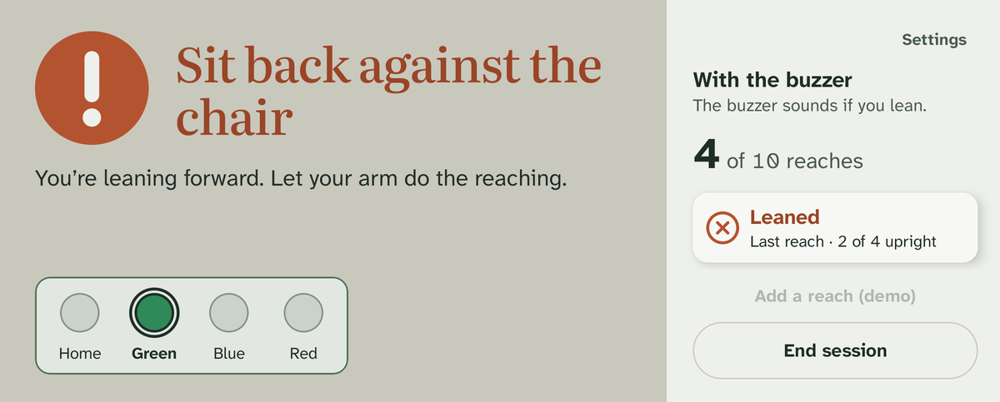 | 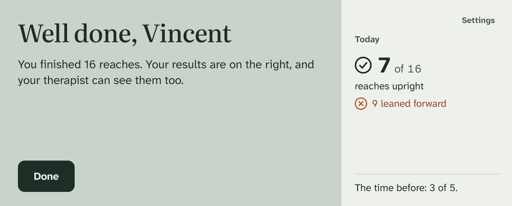 |

There are four exercises: reach forward, reach to the right, hand to mouth, and forearm rotation.
Settings has a Demo mode with short scripted runs for showing the buzzer off.

**The dashboard** (web). Where the therapist follows each patient: how often they lean, whether
that's going down, at which targets, and a short written summary.

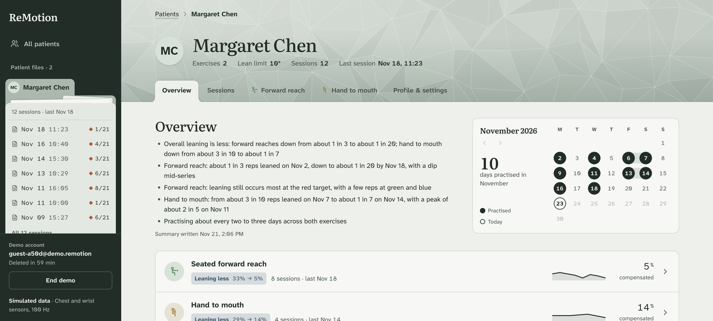

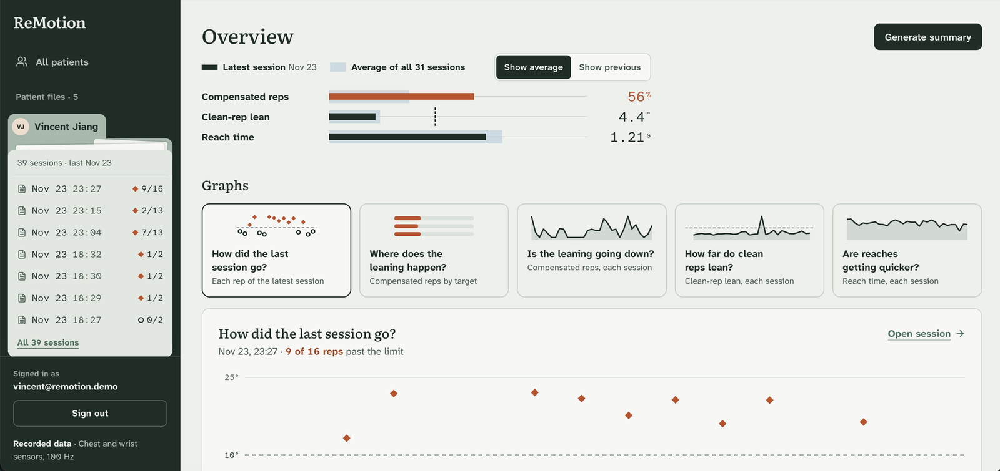

### Rep replay

Any single reach can be played back in 3D from the recorded sensor data, with the trunk-lean and
wrist-speed traces beside it. The trunk turns warm when it passes the limit.

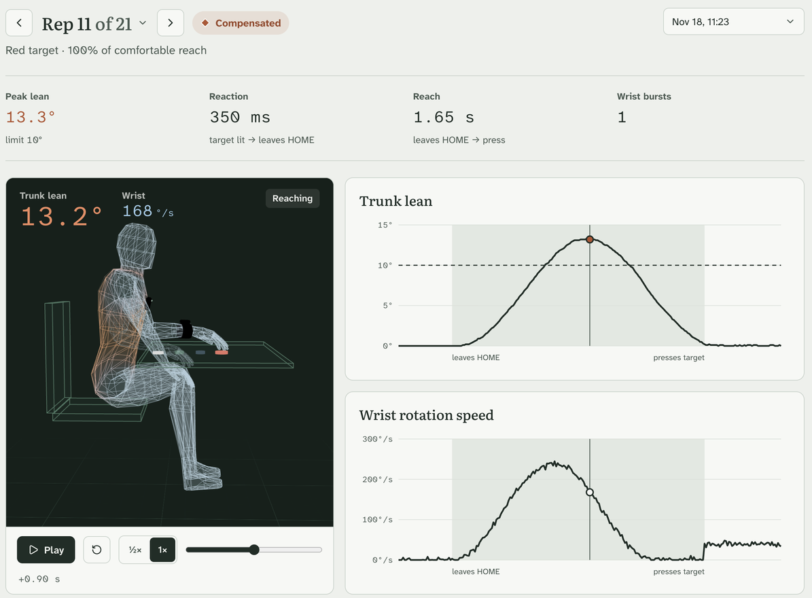

| Forward reach | Hand to mouth |
|---|---|
| 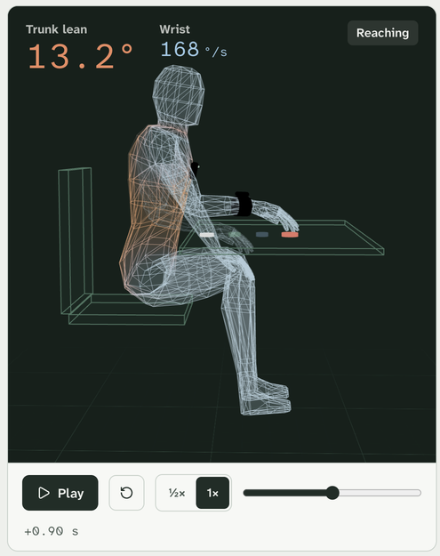 | 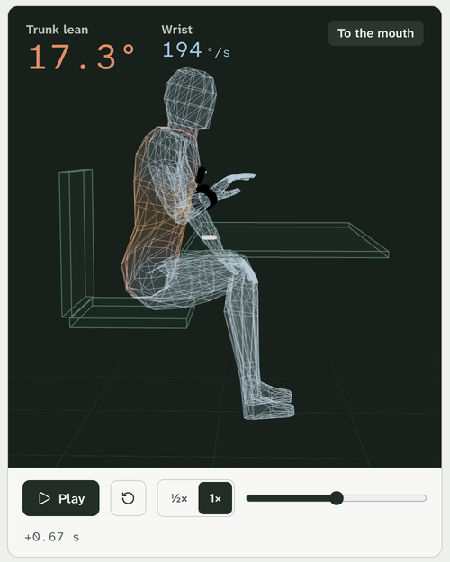 |

The patient overview and the replays above use simulated data, made to build and test the dashboard. The exercise page shows real sessions recorded with the device during team testing.

## How it fits together

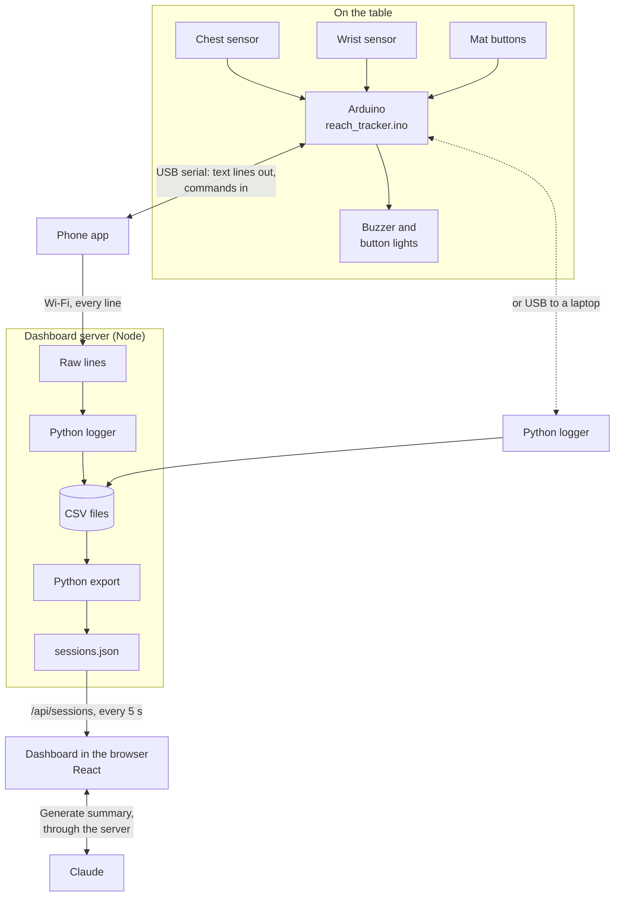

- **The Arduino decides.** It reads both sensors 100 times a second, runs the session, judges
  every reach and sounds the buzzer itself. Nothing it does depends on the phone or the laptop,
  so the feedback never lags.
- **Everything else listens.** The Arduino prints plain text lines: one per reach (`R`), one
  status line (`I`), and live samples (`D`) for the replay. The phone and the laptop logger read
  the same lines and can send a few one-letter commands back (start, stop, plan, lean limit). The
  format is in [`docs/PROTOCOL.md`](docs/PROTOCOL.md).
- **The dashboard reads files.** The server saves the phone's lines as they arrive, runs the
  same Python logger the laptop uses to turn them into CSV files, then a Python export gathers
  every session into one `sessions.json` per account. The dashboard fetches it every 5 seconds,
  so a new reach shows up within a few seconds. A laptop recording joins the same CSV files.
- **Summaries come from Claude.** "Generate summary" sends a patient's numbers to Claude through
  the server, and the short written overview comes back.

### Hardware

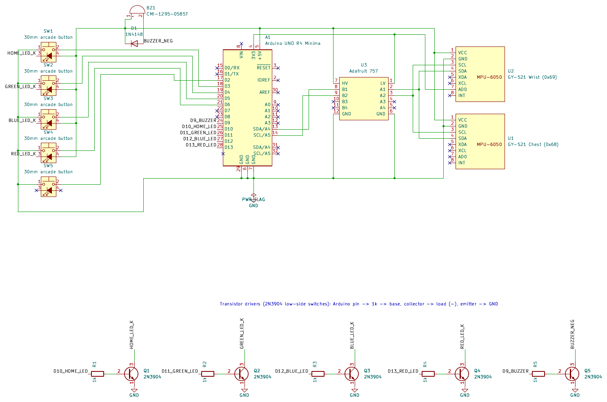

| Part | Job |
|---|---|
| Arduino UNO R4 Minima | Reads the sensors and buttons, runs the session, drives the lights and buzzer |
| 2× MPU-6050 (GY-521) | Motion sensors. Chest: how far the trunk tilts. Wrist: when the arm moves |
| Adafruit 757 level shifter | Lets the 5 V Arduino talk to the 3.3 V sensors |
| 5× 30 mm lit arcade buttons | START (D2), then HOME, GREEN, BLUE, RED (D3–D6) |
| 5× 2N3904 transistors | Switch the button lights and the buzzer, which need more current than a pin gives |
| Buzzer | The only feedback during a reach |

Both sensors share one I2C bus. The wrist sensor's AD0 pin is tied high, so it answers at 0x69
and the chest sensor at 0x68. One cable runs from the mat to the wrist board (which carries the
level shifter) and on to the chest. KiCad files are in [`hardware/kicad/`](hardware/kicad/), and
there's a full-size [PDF of the schematic](docs/imu-reach-tracker-schematic.pdf).

## Run it

You need Python 3, Node 24, and for the device, the Arduino IDE or `arduino-cli`.

**Just the dashboard, with simulated patients** (no hardware):

```bash
python3 -m venv .venv && .venv/bin/pip install -r requirements.txt
.venv/bin/python -m software.dashboard.fake_history     # makes three simulated patients
cd software/web && npm install
node server/set-owner.ts you@example.com                # your login; prints a password once
npm run dev
```

Open http://localhost:5173 for the landing page, or http://localhost:5173/dashboard to sign in.
"Try a 1-hour demo" on the sign-in page works without an account. Summaries need an
`ANTHROPIC_API_KEY` in `software/web/.env`; everything else works without one.

**The device:**

1. Install the **Arduino UNO R4 Boards** package and the **Adafruit MPU6050** library.
2. Upload `firmware/reach_tracker/reach_tracker.ino`
   (`arduino-cli compile --upload --fqbn arduino:renesas_uno:minima -p <port> firmware/reach_tracker`).
3. Strap on the sensors, sit up straight, press the yellow START button. Three beeps mean the
   session is done.

To record a session on a laptop instead of the phone: `.venv/bin/python -m software.tools.logger`.
`./demo.sh` runs the short demos from the terminal.

**The phone app:**

```bash
cd software/android && ./gradlew installRelease     # with the phone plugged in and USB debugging on
```

No cable? Build it with `./gradlew assembleRelease`, then on the dashboard open a patient's
**Profile & settings → Connect a phone → Don't have the app?** and scan that code with the
phone's camera. Then scan the pairing code with the app, and the phone records as that patient.

The phone must be able to reach the dashboard, so run it with `npx vite --host` and open it at
the laptop's network address rather than `localhost`. Campus Wi-Fi blocks this; a phone hotspot
works. [`docs/HANDOFF.md`](docs/HANDOFF.md) walks through the whole setup, and
[`docs/MANUAL.md`](docs/MANUAL.md) covers running a session step by step.

## In this repo

| Folder | What's there |
|---|---|
| `firmware/reach_tracker/` | The Arduino program |
| `software/android/` | The phone app (Kotlin, Jetpack Compose) |
| `software/web/` | Landing page, dashboard and its server ([README](software/web/README.md)) |
| `software/tools/`, `software/dashboard/` | Python: logger, protocol parser, fake data, export |
| `software/analysis/` | Validation: label sheets and threshold sweeps |
| `hardware/` | Schematic, perfboard layout, enclosures, mat |
| `docs/` | Protocol, manual, testing plan, research notes, team status |

Working on the code? Read [`AGENTS.md`](AGENTS.md) first.

## Team

[Vincent Jiang](https://github.com/vinyx1) ·
[Yousuf Hamoda](https://github.com/Yousuf-Hamoda) ·
[Preston Baichoo](https://github.com/prestonbaichoo3) ·
[Ali Hadi](https://github.com/Ali-Hadi123)

A student prototype, tested only on team members. Not a medical device. The 10° limit is a
starting point that still needs a clinician's eye, and the sensors can't see the trunk twisting,
only tipping forward or sideways.
